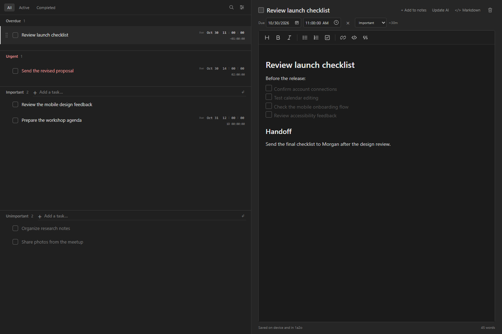
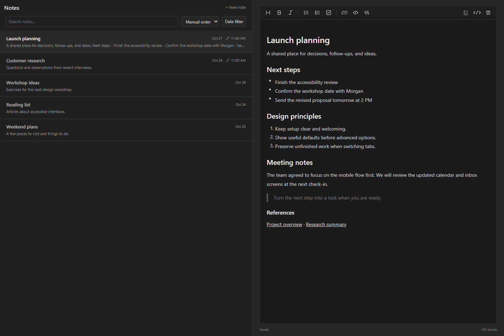

# 1a2o

A personal workspace for mail, messages, calendars, tasks, notes, contacts, and AI. A public fork of [Inbox Zero](https://github.com/elie222/inbox-zero), powered by **OpenRouter** for classification and task analysis, with optional ChatGPT sign-in for Chat.


## Start here

- **New installation:** [Getting started](docs/GETTING-STARTED.md), then [local server configuration](LOCAL-SETUP.md).
- **Android phone or tablet:** [Install and pair Android](docs/ANDROID.md). Reuses an existing installation and its connected accounts; Agents stays on desktop.
- **See the app:** [Feature gallery](docs/FEATURES.md). Every screenshot uses fictional data in isolated copies of the real interface.
- **Tasks and Notes backup:** [Private cloud sync and recovery](docs/SYNC.md).

## What is included

| Workspace | Features |
| --- | --- |
| Mail | Gmail and Outlook together by default; cached lists and counts; split preview; account colors; keyboard navigation; recoverable drafts; send, reply, forward, attachments, scheduled mail and reminders. |
| Messages | Beeper-connected networks, one conversation per row, groups and direct messages, platform filters, rule labels, combined conversations with a send-account switch, queued image attachments, media viewer, links, and platform-supported replies, edits, reactions, recall and forwarding. Discord servers are excluded. |
| Calendar | Unified month and editable day timelines, persistent calendar visibility, distinct calendar colors, writable-calendar selection, drag to move and Alt-drag to copy. Provider permissions determine which originals can be edited. |
| Tasks | Quick entry, AI time/deadline analysis, overdue and priority groups, rich notes, calendar event creation with duplicate review, deadline reminders, and transfer to Notes. |
| Notes | Markdown and rich-text editing, automatic first-line titles, drag ordering, date filters and compact timestamps, and AI-assisted transfer to Tasks. |
| Contacts | Profiles across supported networks and mail, exact-name deduplication with retained unique fields/profile links, and optional LinkedIn sync. Messaging-network APIs determine available contact details. |
| Chat | Original in-app assistant with application tools and data; model/thinking controls and keyboard shortcuts; OpenRouter or optional ChatGPT connection; Open in ChatGPT button. ChatGPT subscription login is separate from OpenRouter classification. |
| Agents | Desktop Codex CLI panels, conversation picker, title refresh, drag ordering, native terminal keys, optional multi-call scheduler, reset-aware timing, and task attention alerts. |
| Tools | Rules separated by Mail, Messages, Calendar and Tasks; classification usage history and daily graphs; cleanup tools and combined-inbox bulk unsubscribe with resumable history scanning. |






More screenshots, including Contacts, Chat, Agents, Rules, Usage, bulk unsubscribe and Android pairing, are in the [gallery](docs/FEATURES.md).

## AI and quotas

The optional local OpenRouter gateway persists minute/day request counters, uses an absolute **00:00 UTC** daily reset, and applies cooldowns. Configuration does not upgrade an OpenRouter account. The conservative default is 20 requests/minute and 50/day; use your provider's actual allowance. Existing-mail tagging is capped at 500 calls/day in the configured edition; bulk tagging can classify ten emails per call, with capacity reserved for new mail and interactive requests. Message conversations are reclassified only when relevant content, title or rules change, with the configured daily existing-chat cap.

The Usage tool shows recorded usage and failures by feature and day. AI-selected content is sent to the configured provider. Provider latency, quotas and platform-specific API capabilities still apply.

## Local, Android and cloud

The backend runs on your computer or a self-hosted server. It owns OAuth credentials, email/calendar operations, Beeper access, AI automation and persistent data. Android connects to that same backend instead of requiring you to configure accounts twice. Beeper Desktop must be available on the backend host for its messaging APIs. Android includes uploads/downloads, external-browser authorization and optional background notifications; the server must be reachable for live mail/messages/calendar operations.

Tasks and Notes retain local copies and have a separate encrypted cloud-sync path. Consult [sync and recovery](docs/SYNC.md) for the exact offline, conflict and recovery behavior. This is not a claim that email providers or AI run offline.

The repository contains source, synthetic screenshots, example configuration and reproducible build scripts. It excludes credentials, OAuth exports, mailbox databases, private screenshots, device sessions, signing keys and local build artifacts. APKs belong in GitHub Releases, not source control.

## Upstream and licensing

This repository remains a fork of Inbox Zero. Upstream licensing and additional terms are unchanged; see [LICENSE](LICENSE). The vendored Tasks editor retains its [source attribution and license](apps/web/public/open-todo-zero/INTEGRATION.md). Inter and other vendored dependencies retain their own notices.

<details>
<summary>Original Inbox Zero documentation</summary>


[](https://www.getinboxzero.com)

<p align="center">
  <a href="https://www.getinboxzero.com">
    <h1 align="center">Inbox Zero - your 24/7 AI email assistant and email app</h1>
  </a>
  <p align="center">
    Organizes your inbox, pre-drafts replies, manages your calendar, and organizes attachments. Chat with it from Slack or Telegram to manage your inbox on the go. Open source alternative to Fyxer, but more customizable and secure. We also offer an email app, an open source alternative to Superhuman.
    <br />
    <a href="https://www.getinboxzero.com">Website</a>
    ·
    <a href="https://www.getinboxzero.com/discord">Discord</a>
    ·
    <a href="https://github.com/elie222/inbox-zero/issues">Issues</a>
  </p>
</p>

<div align="center">


<a href="https://trendshift.io/repositories/6400" target="_blank"></a>

[](https://vercel.com/oss)

</div>

## Mission

To help you spend less time in your inbox, so you can focus on what matters most.

## Features

Inbox Zero has two parts: an AI email assistant that works in the background on your Gmail or Outlook account, and an email client. Each works on its own.

### AI email assistant

- **AI Personal Assistant:** Organizes your inbox and pre-drafts replies in your tone and style.
- **AI Rules for email:** Explain in plain English how your AI should handle your inbox.
- **Reply Zero:** Track emails to reply to and those awaiting responses.
- **Bulk Unsubscriber:** One-click unsubscribe and archive emails you never read.
- **Bulk Archiver:** Clean up your inbox by bulk archiving old emails.
- **Cold Email Blocker:** Auto‑block cold emails.
- **Email Analytics:** Track your activity and trends over time.
- **Meeting Briefs:** Get personalized briefings before every meeting, pulling context from your email and calendar.
- **Smart Filing:** Automatically save email attachments to Google Drive or OneDrive.
- **Slack & Telegram Integration:** Chat with your AI assistant from Slack or Telegram to manage your inbox without leaving the apps you already use.

### Email client

A fast email client for Gmail and Outlook, with a split inbox, all your accounts in one place, and team comments.

- **Web and desktop:** open source. The desktop app is Electron, in [`apps/desktop`](apps/desktop).
- **iOS:** a native Swift app, not open source yet. The [App Store app](https://www.getinboxzero.com/app) can connect to your own server URL if you self-host.
- **Android:** an older React Native [Android app](https://www.getinboxzero.com/android).

Learn more in our [docs](https://docs.getinboxzero.com).

## Demo

[](https://player.mux.com/YeTrweHxCIM5tcBMXlvRbmDuPqL028lJrmJ3F6ZgwnDY)

## Built with

- [Next.js](https://nextjs.org/)
- [Tailwind CSS](https://tailwindcss.com/)
- [shadcn/ui](https://ui.shadcn.com/)
- [Prisma](https://www.prisma.io/)
- [Upstash](https://upstash.com/)
- [Turborepo](https://turbo.build/)
- [Popsy Illustrations](https://popsy.co/)

## Star History

[](https://www.star-history.com/#elie222/inbox-zero&Date)

## Feature Requests

To request a feature open a [GitHub issue](https://github.com/elie222/inbox-zero/issues), or join our [Discord](https://www.getinboxzero.com/discord).

## Getting Started

We offer a hosted version of Inbox Zero at [getinboxzero.com](https://www.getinboxzero.com).

### Self-Hosting

The fastest way to self-host Inbox Zero is with the CLI:

> **Prerequisites**: [Docker](https://docs.docker.com/engine/install/) and [Node.js](https://nodejs.org/) v24+

```bash
npx @inbox-zero/cli setup      # One-time setup wizard
npx @inbox-zero/cli start      # Start containers
```

Open http://localhost:3000

For complete self-hosting instructions, production deployment, OAuth setup, and configuration options, see our **[Self-Hosting Docs](https://docs.getinboxzero.com/hosting/quick-start)**.

### Local Development

> **Prerequisites**: macOS or Linux (WSL on Windows), [Node.js](https://nodejs.org/) v24, and the pnpm version pinned in `package.json`. Install either [Docker Desktop](https://docs.docker.com/desktop/) with Compose or native PostgreSQL and Redis. On macOS, native services can be installed with `brew install postgresql@16 redis`.

```bash
git clone https://github.com/elie222/inbox-zero.git
cd inbox-zero
pnpm install
pnpm local:start
```

Open http://localhost:3000/mail and sign in with Google as `developer@example.com`, or Microsoft as `developer@outlook.test`. The Google mailbox contains demo messages. Demo users have onboarding completed, and premium checks are bypassed for local development.

The command starts an isolated database, Redis and its HTTP endpoint, both mail-provider emulators, billing and email-delivery emulators, an LLM emulator, and Next.js. It applies migrations and waits for services to become ready. No OAuth credentials or AI API keys are required. AI responses are canned; this mode exercises application flows, not model quality.

Existing `.env` files are left unchanged and ignored by this launcher. Generated credentials, seed data, and the current service addresses are stored under `.context/local-dev/`. Native database data stays there; Docker database data stays in a volume unique to the checkout. Restarts preserve database data and credentials. Redis caches and provider/emulator state start fresh on each run.

Press **Ctrl-C** to stop the app and the services this command started. Start it again with the same command. If port 3000 is occupied, use `pnpm local:start --port 3001`. Native PostgreSQL and Redis are selected when available; use `--backend docker` or `--backend native` to select explicitly. A checkout-specific loopback port prevents concurrent launchers; the operating system releases that lock after a crash, and stale PID files are replaced automatically. Services use automatically assigned ports, so existing databases and Redis instances are not reused or stopped.

Run `pnpm local:start --help` for options. If an unrelated process occupies the reported lock port, stop that process or use a different checkout location. PostgreSQL data must be opened with the same major version that created it. If you upgrade your native PostgreSQL major version, back up or move `.context/local-dev/postgres` before starting a new cluster.

For development against real providers, continue to use `pnpm setup`, your own environment files, and `pnpm dev`. See the **[Contributing Guide](https://docs.getinboxzero.com/contributing)** for configuration and devcontainer setup.

## Contributing

View open tasks in [GitHub Issues](https://github.com/elie222/inbox-zero/issues) and join our [Discord](https://www.getinboxzero.com/discord) to discuss what's being worked on.

Docker images are automatically built on every push to `main` and tagged with the commit SHA (e.g., `elie222/inbox-zero:abc1234`). The `latest` tag always points to the most recent main build. Formal releases are tagged with the version number without the `v` prefix (e.g., git tag `v2.30.0` → `ghcr.io/elie222/inbox-zero:2.30.0`), plus a minor alias (e.g., `2.30`).

</details>
