

# 1a2o

**Your mail, messages, calendar, tasks, notes, contacts, AI chat, and coding agents in one workspace.**

1a2o brings communication and planning together in a dark desktop workspace, with an Android companion. OpenRouter powers background classification and task analysis. Chat can use OpenRouter or a separate ChatGPT sign-in. You choose which accounts and services to connect.

[Get started](docs/GETTING-STARTED.md) | [Android](docs/ANDROID.md) | [Screenshot gallery](docs/FEATURES.md) | [Backup and recovery](docs/SYNC.md) | [Releases](https://github.com/thencious/1a2o/releases)

| Tasks | Notes |
| --- | --- |
|  |  |

## Explore by tab

[Mail](#mail) | [Messages](#messages) | [Calendar](#calendar) | [Tasks](#tasks) | [Notes](#notes) | [Contacts](#contacts) | [Chat](#chat) | [Agents](#agents) | [Tools](#tools) | [Settings and Android](#settings-and-android)

Tabs can be dragged into your preferred order. Resizable panels, retained workspace state, dark account/platform colors, and keyboard navigation connect the different parts of the app.

## Mail

A Gmail and Outlook client built on [Inbox Zero](https://github.com/elie222/inbox-zero), expanded into 1a2o's Mail tab. This repository preserves that fork relationship and its license.

- All accounts by default, with individual mailbox views and account colors.
- Compact mail lists, cached recent mail and tag counts, and a separate reading column.
- AI classification, multi-label filters, category focus, and editable rules.
- Compose, drafts, reply, forward, attachments, scheduled sending, and reminders.
- Up/down navigation, recipient addresses in the list and reader, Sent, Drafts, Archive, Spam, and Trash views.
- Manual refresh, reconnect warnings, and background history synchronization.

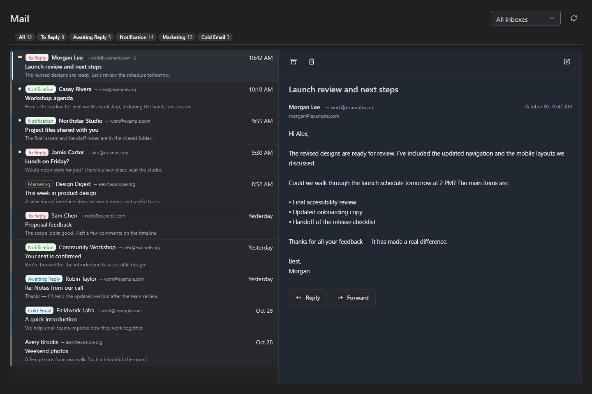

## Messages

One conversation list across Beeper-connected accounts, with the newest message from each conversation. Groups are included; Discord servers are excluded.

- Platform filters and Business, Casual, Notification, and Other rule labels.
- Ctrl-click selection and conversation combining, with optional contact combining.
- Combined histories retain platform colors; choose the account used for the next message.
- Immediate outgoing bubbles, delivery status, queued pasted images with removable thumbnails, media viewing, and link previews.
- Replies, mentions, editing, reactions, recall, forwarding, and read receipts **where the network exposes them**.
- `/invite` prepares a meeting from recent conversation context and contacts; `/add` extracts and combines contact information. Other slash requests can go to Chat with their location as context.

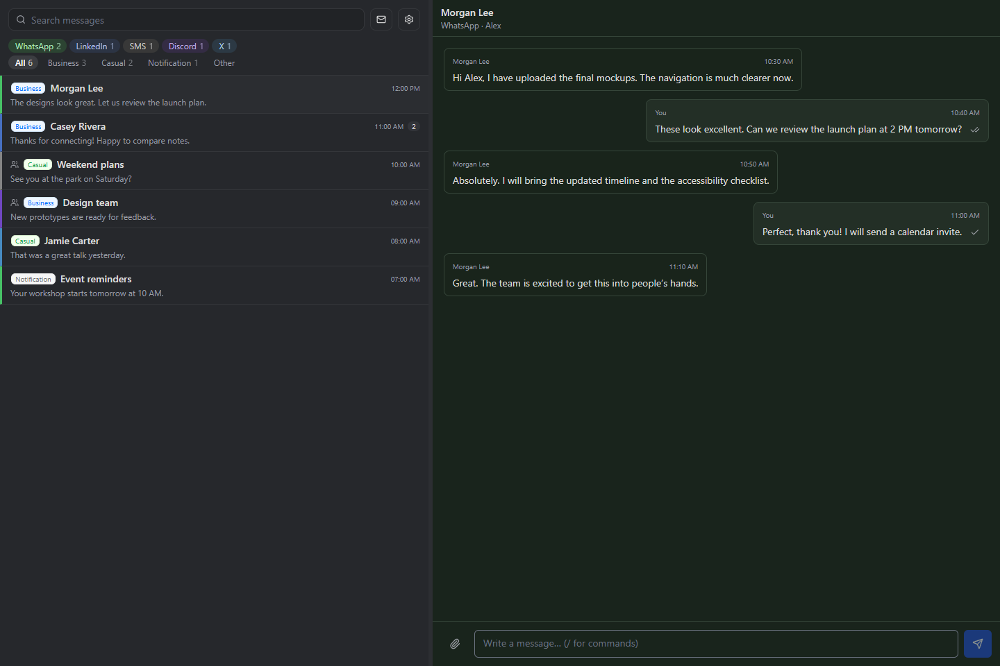

[Message commands and meeting setup](MESSAGE-COMMANDS.md)

## Calendar

- Google and Outlook calendars together in a monthly view, with cached events across restarts.
- Click a date for an editable single-day timeline; use its **+** control to create an event.
- Drag to move events and Alt-drag to copy, with protection against copying into the original position.
- Distinct colors for visible calendars, persistent visibility/archive choices, and a default calendar.
- Provider-supported event editing, attendee invitations, and Google Meet or a configured Zoom meeting link.

Calendar permissions still apply: read-only originals remain read-only, while an editable copy can be created in a writable calendar.

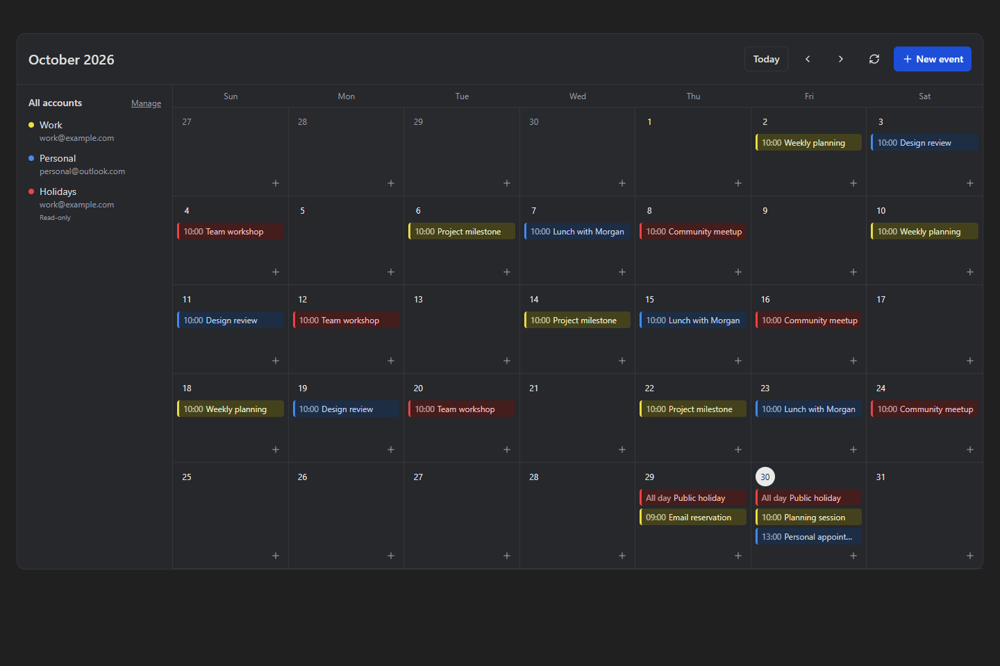
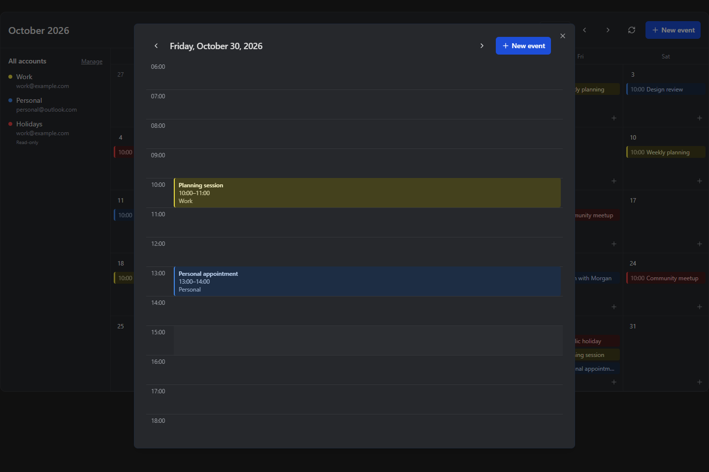

## Tasks

- Quick task entry, Overdue, Urgent, Important, and Unimportant sections, and a separate Completed view.
- Natural-language deadline and work-estimate analysis through OpenRouter, plus manual overrides.
- Due dates, priority and effort controls, checkboxes, and resizable sections and detail panels.
- Live Markdown details, undo/redo, and **Add to Notes**.
- Calendar creation for explicit events/deadlines, including date-only all-day items and duplicate-event review.
- Configured phone reminders, Windows notifications, and attention indicators.

## Notes

- Obsidian-style live Markdown editing: syntax reveal, headings, lists, checkboxes, tables, callouts, code highlighting, math, and source mode.
- Links between notes, note embeds, search, manual drag ordering, and date sorting/filtering.
- Automatic first-line titles and compact creation/edit timestamps.
- **Add to Tasks** summarizes the note into a task and detects its time; missing times use a nonblocking prompt.
- Immediate local saving, backend persistence, encrypted cloud backup, and retained recovery history.

The editor integrates [like_obsidian_md_viewer](https://github.com/zacharyyamaoka/like_obsidian_md_viewer), derived from atomic-editor, while retaining 1a2o's interface. [Editor attribution](apps/web/vendor/obsidian-editor/SOURCE.md)

## Contacts

- A unified directory from email address books, supported messaging accounts, and LinkedIn imports.
- Automatic duplicate matching retains distinct details, aliases, and links to original profiles.
- **Ctrl-click contacts, right-click, then Combine contacts** for manual combinations, including different names and multiple profiles on the same platform.
- Combined contacts still appear under each relevant platform filter, and combinations persist across source refreshes.
- Optional LinkedIn browser-session sync from its account row. The provider determines which emails, phone numbers, and profiles are available.

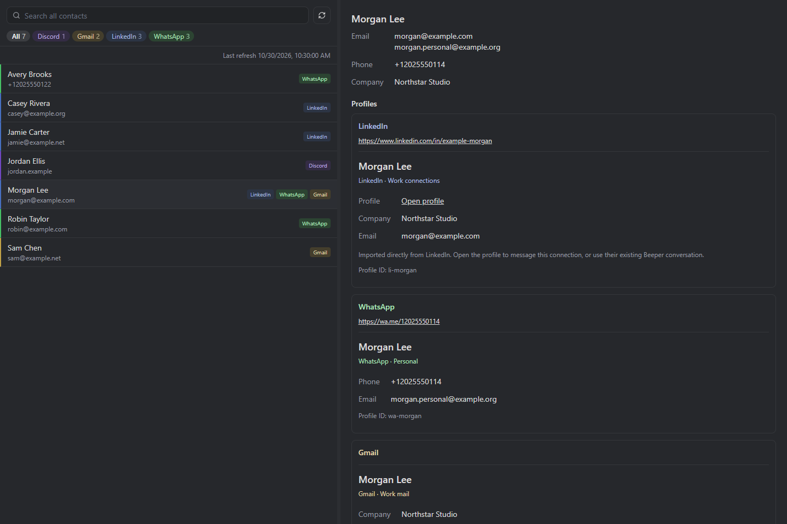
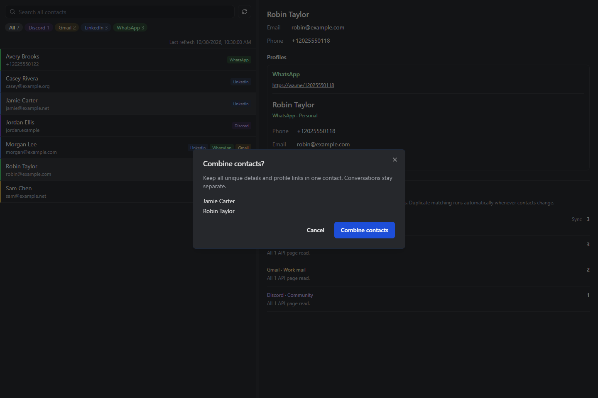

[LinkedIn connection guide](LINKEDIN-CONTACTS.md)

## Chat

- An in-app assistant with access to application data and tools across workspaces.
- OpenRouter or optional ChatGPT sign-in; the ChatGPT account is separate from background OpenRouter automation.
- Model and thinking-level controls beside the input, with account controls tucked away.
- Shift+Up/Down changes thinking level; Ctrl+Shift+Up/Down changes model.
- Attachments, contextual slash requests, and an **Open in ChatGPT** shortcut.

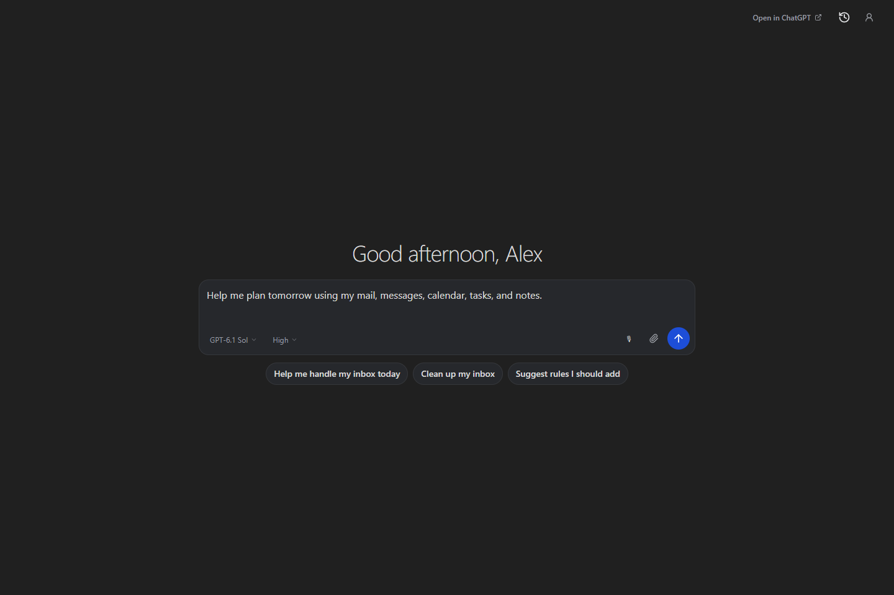

## Agents

Desktop coding-agent sessions with live CLI output and native terminal input.

- Open a new chat or resume an existing conversation from the conversation picker.
- Up to four columns; additional sessions use a second row. Drag titles to reorder panels.
- Preserve CLI shortcuts and terminal interactions.
- Collapsed controls by default; expand the timer to configure a schedule.
- Multiple individually cancellable scheduled calls, with an additional call defaulting to an hour later. Enter schedules rather than sending immediately.
- Windows notifications and attention indicators when supported agent events require a response or report completion.

Agents requires the local desktop host and is omitted from Android.

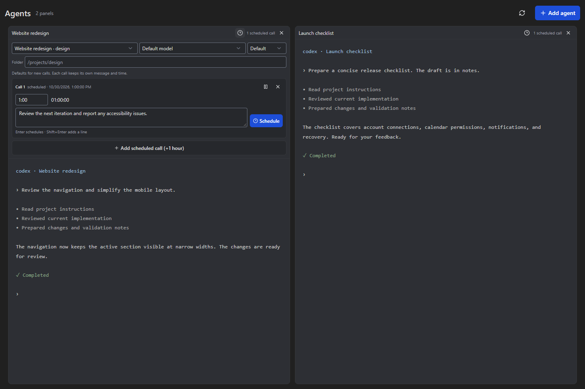

## Tools

### Rules

Separate Mail, Messages, Calendar, and Tasks areas, with rule creation, labels, history, and testing controls. Message classification runs for new conversations and relevant changes; unchanged conversations are not repeatedly classified.

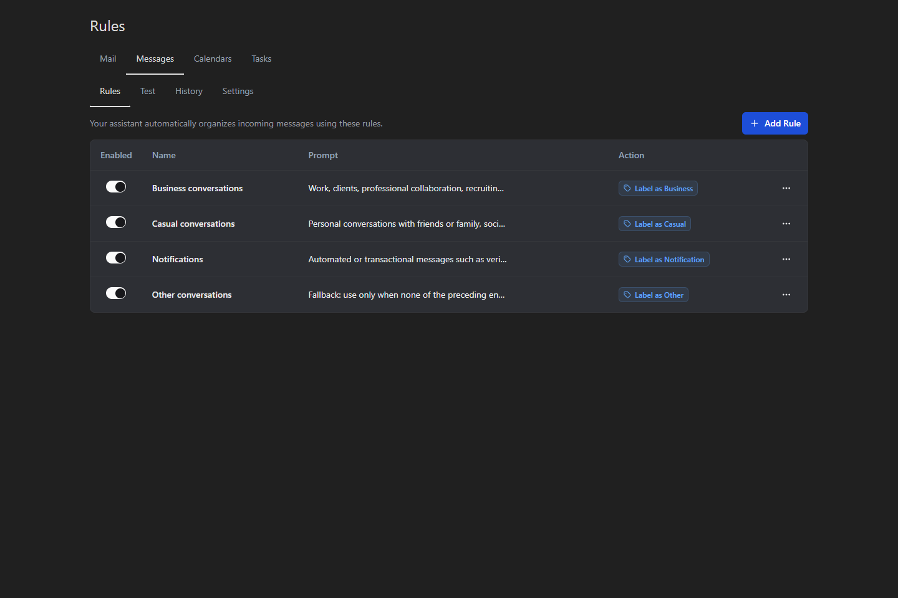

### AI usage

Daily feature breakdowns, hourly graphs, a date selector with previous/next navigation, retained history, and request/error details.

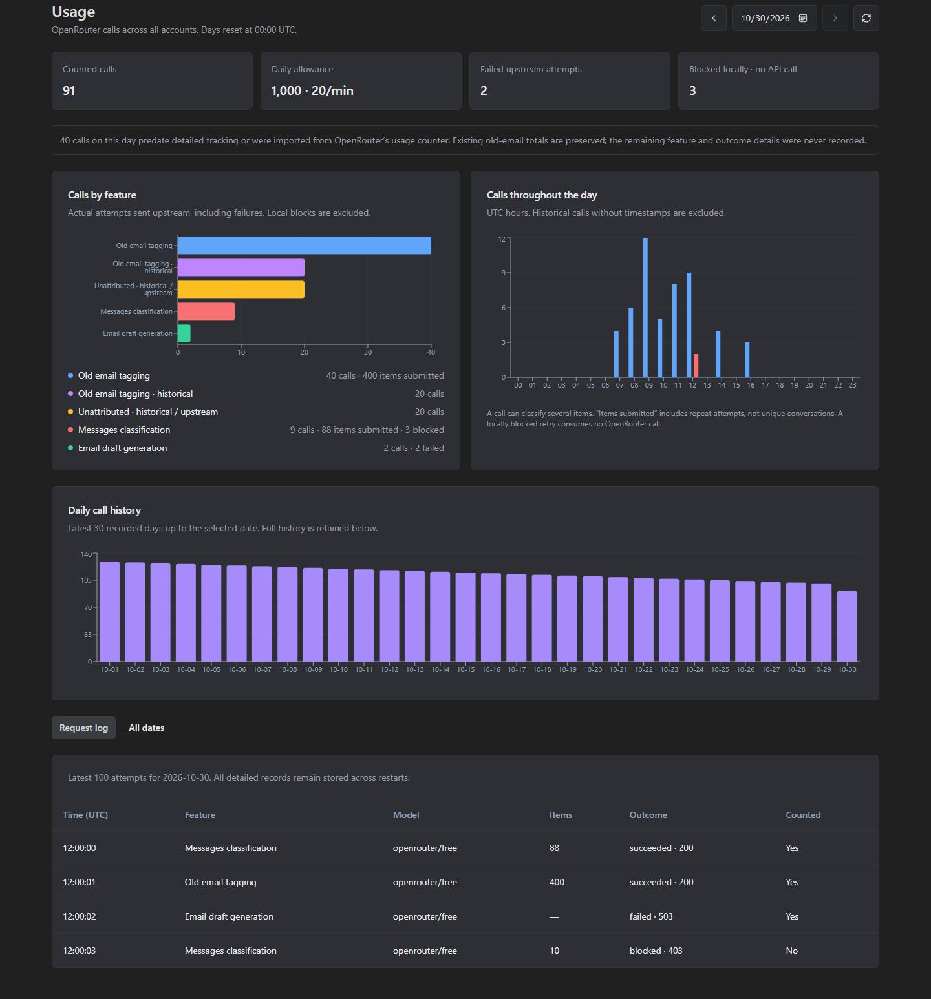

### Cleanup

Bulk unsubscribe defaults to all inboxes and all time, with a mailbox selector, sender counts, read rates, and resumable history scanning. Additional cleanup and integration tools live here rather than adding more main tabs.

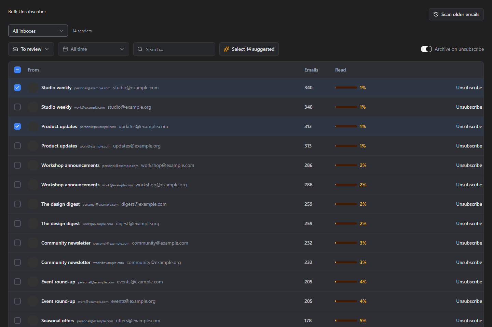

## Settings and Android

- Connected accounts, calendar permissions and visibility, default calendar/meeting service, AI accounts, devices, and cloud recovery settings.
- Windows startup/background operation, notifications that open the appropriate workspace, attention dots, and taskbar attention.
- Updates show progress at the bottom right and install after validation.
- Pair Android with a one-time code/QR instead of signing into every provider again.
- Android shares the backend's accounts and data, supports files/media and optional background notifications, and retains local Tasks/Notes copies.

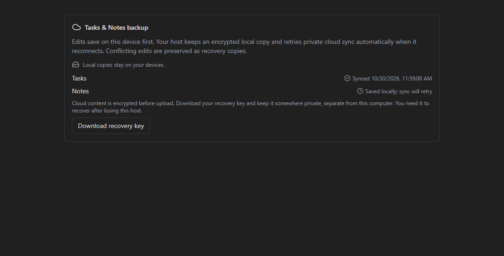
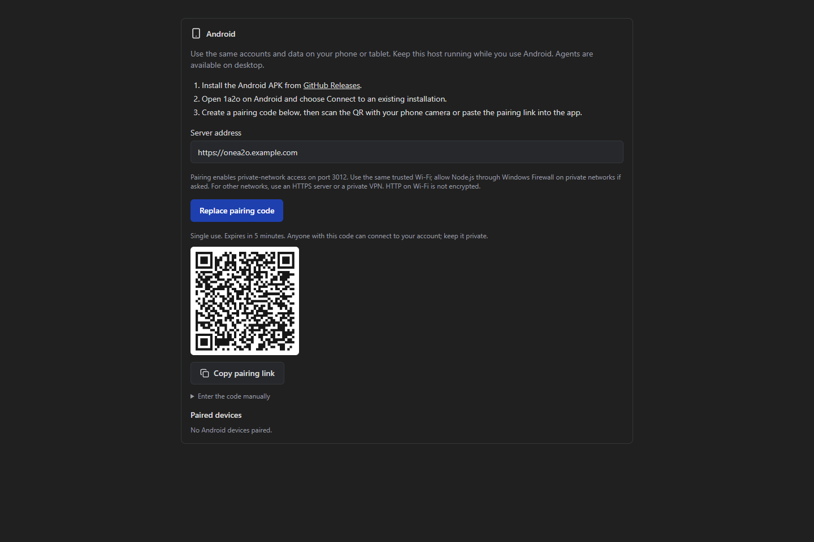

[Android installation and limitations](docs/ANDROID.md) | [Private sync and recovery](docs/SYNC.md)

## Install and connect

Start with [Getting started](docs/GETTING-STARTED.md), then follow the [local server guide](LOCAL-SETUP.md). The backend runs on your Windows computer or a self-hosted server. Provider OAuth apps and API keys are supplied by the installer; credentials are not included here.

Mail, messaging, calendars, agents, and AI need their configured services. Beeper Desktop runs on the backend host. Android needs a reachable backend for live provider operations; Tasks and Notes retain local copies and can sync with the configured private cloud independently.

Tasks and Notes currently have both a backend cloud worker and direct browser cloud synchronization, using revision checks and conflict recovery. See the [sync architecture and recovery guide](docs/SYNC.md) for the precise behavior and tests. This is not a collaborative text CRDT or a guarantee of zero conflicts.

## OpenRouter usage

The optional gateway persists request counters and cooldowns and resets daily quotas at **00:00 UTC**. Set limits to your actual provider allowance. The default configuration is conservative; adding credits does not remove model-specific rate limits.

The configured existing-mail classifier uses batches of up to ten emails, an old-mail budget of 500 calls/day, and reserved capacity for new mail and interactive work. Tools | Usage shows where recorded calls were spent, including failures. AI features send selected content to the configured provider.

## Screenshots, source, and licenses

Screenshots use fictional people, reserved example addresses, simulated provider responses, and synthetic terminal output. They demonstrate the interface; sends, invitations, AI calls, and scheduled agent execution are not performed for screenshots. [Full gallery and reproduction commands](docs/FEATURES.md)

Credentials, mailbox databases, personal exports, private QA captures, cloud recovery keys, and signing keys are excluded from the repository. Android packages are distributed through [Releases](https://github.com/thencious/1a2o/releases).

See [LICENSE](LICENSE) for the applicable license and additional terms, and the source notices for vendored editors, fonts, and dependencies. Renaming the project does not replace those licenses.
